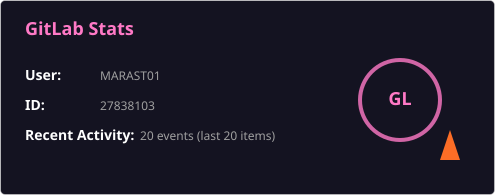

<!-- ============ BANNER ============ -->

  

<!-- ============ TYPING ANIMATION ============ -->

  

 

<!-- ============ CONTACT ============ -->

  
  
  

 

<!-- ============ ABOUT ME ============ -->
<h3 align="center">👨‍💻 About Me</h3>

| | |
|:--|:--|
| 👤 **Name** | Marlon Astudillo Muñoz |
| 🔭 **Studying** | Systems Engineering |
| 📚 **Learning** | Web Development |
| ⚡ **Hobbies** | Video games & going outside |
| 📍 **Location** | Colombia 🇨🇴 |

 

<!-- ============ TECH STACK ============ -->
<h3 align="center">🛠 Languages and Tools</h3>

**Languages**  

  

**Frontend & Backend**  

  

**DevOps, Cloud & Database**  

  

**Tools**  

 

<!-- ============ STATS ============ -->
<h3 align="center">📊 GitHub Stats</h3>

  
  

 

<h3 align="center">🦊 GitLab Stats</h3>

  

 

<!-- ============ ACTIVITY ============ -->
<h3 align="center">📈 Contribution Graph</h3>

  

 

<h3 align="center">🐍 Snake Contribution Game</h3>

  

<!-- ============ FOOTER ============ -->

  

